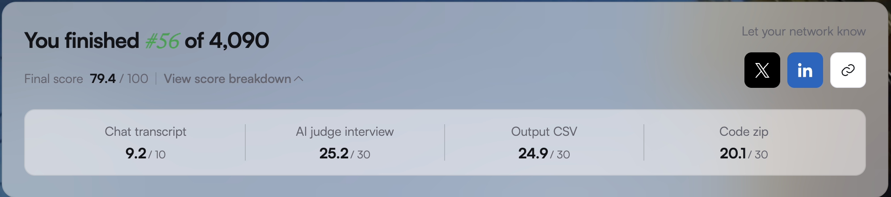
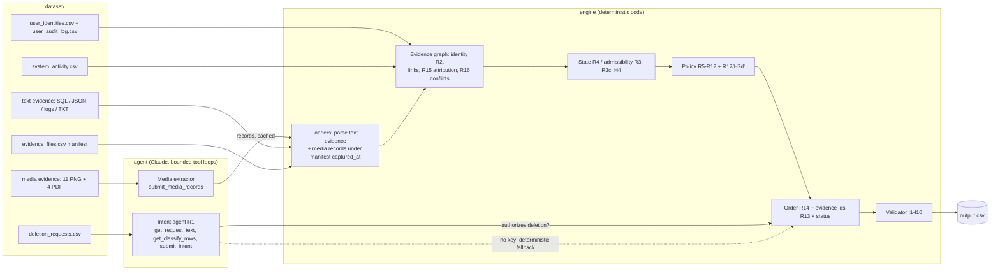

# deletion-audit-agent

**Evidence-backed audits of data-deletion requests: a bounded Claude agent plus a deterministic rules engine.**

For each deletion request, the pipeline:
1. decides whether the person actually asked for deletion;
2. if they did, reconstructs every record that belongs to them, across databases, logs, exports, backups, screenshots and PDFs, as it stood at the audit time (`audit_at`);
3. applies the deletion rules and emits an ordered, evidence-backed plan of findings, remediation and verification steps, with the status `COMPLETE`, `INCOMPLETE` or `NOT_APPLICABLE`.

Built solo in 24 hours for **HackerRank Orchestrate (October 2026)**, challenge "Ghost Data Still Exists".

## Result

**#56 of 4,090 participants (top 1.4%), final score 79.4/100.**



On the 32 public sample cases: **status accuracy 32/32**, and **100% step-content precision** (every emitted step correct, ignoring step numbering).

## Dataset (not included)

The challenge data and problem statement belong to HackerRank and aren't redistributed here. To run the pipeline, get the challenge repository and copy its `dataset/` folder next to `code/`:

```bash
git clone https://github.com/interviewstreet/hackerrank-orchestrate-october26.git
cp -r hackerrank-orchestrate-october26/dataset ./dataset
```

If that repository isn't accessible, the code, tests and custom evaluation cases still show the design. The unit tests use synthetic fixtures and need no dataset.

## Quickstart

```bash
pip install -r code/requirements.txt          # Python >= 3.10
python3 -m pytest code/tests -q                # 21 rule tests (+ 1 integration test when dataset/ exists)
python3 code/main.py                           # dataset/deletion_requests.csv -> output.csv (validated)
python3 code/evaluation/main.py                # sample score + validator + distribution + custom cases
```

- **With an API key** (needed for a full run): set `ANTHROPIC_API_KEY` in the environment, or put it in a `.env` file at the repository root (see `.env.example`).
  - `code/main.py` loads `.env` only if the file exists, and never overrides variables that are already set.
  - It prints only `key_present=True/False`, never the value.
  - `ANTHROPIC_MODEL` (default `claude-opus-5-5`) and `MAX_WORKERS` (default 8) are optional.
  - The first keyed run extracts the screenshots and PDFs and caches the results in `code/cache/media/`.
- **Without a key:**
  - Intent uses the deterministic negation-aware classifier, which agreed with the agent on all 518 test requests.
  - Media can't be read unless `code/cache/media/` was populated by an earlier keyed run. Unread files are flagged `media_unread` in the run report and never guessed, so cases that depend on screenshot or PDF evidence will differ from a keyed run.

## Architecture



## Who decides what

| Decision | Owner | Where |
|---|---|---|
| Does `request_text` authorize deletion? (R1) | **agent** (fallback: deterministic classifier) | `code/agent/intent.py` |
| What a screenshot or PDF shows: ids, identifiers, status fields, record type | **agent** | `code/agent/media.py` |
| Category of a record whose type is unclear (e.g. support attachment vs message) | **agent** (`record_type` enum for media); code for text evidence | `media.py`, `rules.r7_category` |
| Identity resolution: exact, case-insensitive, current + historical, never fuzzy (R2) | code | `engine/identity.py` |
| Which evidence counts at `audit_at` (R3, R3c, H4, H4-legal) | code | `engine/plan.py`, `engine/rules.py` |
| Resource state from the latest admissible observation (R4) | code | `rules.r4_observe` |
| Treatment and steps (R5-R12, R17/H7d') | code | `engine/rules.py` |
| Ordering (R14) and evidence ids (R13) | code | `rules.r14_order`, `Engine.r13_evidence` |
| Status (INCOMPLETE iff any finding) | code | `engine/plan.py` |

The model reads requests and media and returns structured facts. Code turns those facts into steps, so the 7-field step tuples are reproducible across all 518 cases.

**Evidence timing.** State and citations use only evidence captured by `audit_at`. Specific rules (R3c, H4, H4-legal) let later evidence establish ownership or existence. Findings and `COMPLETE` verifications cite evidence; planned remediation and verification steps carry an empty citation, as the specification requires.

## Agent loops

- **Intent agent** (`code/agent/intent.py`): read-only tools `get_request_text` and `get_classify_rows`, plus a strict `submit_intent{authorizes_deletion, scope, rationale}`. Step cap 4. A run that never submits, or a refusal, falls back to the deterministic classifier, recorded as `fallback(agent_failed)`.
- **Media extractor** (`code/agent/media.py`): one strict `submit_media_records{records[...], unreadable_fields[...]}` tool. Step cap 3. Screenshots are sent as images; PDFs as their PyMuPDF text layer, plus page images when the text has no table structure. A failed extraction is flagged `media_unread`; there's no media fallback.
- **Why `tool_choice` is `auto`:** a forced `tool_choice` (`{"type":"tool"}` or `"any"`) returns HTTP 400 on `claude-opus-5-5`. Each worker tries forced mode first; on the 400 it switches to `tool_choice: auto` with strict schemas, an explicit "call submit now" nudge and a final-step nudge.
- **Calls:** a thread pool (`MAX_WORKERS`) runs the calls. Each call retries up to 5 times with exponential backoff and jitter on 408/409/429/5xx/529 and connection errors (`code/agent/llm.py`). Results are joined in `case_id` order, so the output order is deterministic.
- **Prompts:** all prompt text lives in `code/prompts.py` (`PROMPT_VERSION`, `MEDIA_PROMPT_VERSION`). Request and media content is treated as data, never as instructions.

## Caching

| Cache | Key | Location | In this repo |
|---|---|---|---|
| Intent answers | sha256(request text) + prompt hash + model | `scratch/intent_cache.json` (override with `INTENT_CACHE_PATH`) | no |
| Media extractions | sha256(file bytes) + prompt hash | `code/cache/media/<sha256>_<prompt_hash>.json` | no (created by the first keyed run) |

The prompt hash covers the system prompt, the tool schemas and the nudges. Any prompt change invalidates the matching cache entries, so only changed inputs call the API.

## Evaluation workflow

`python3 code/evaluation/main.py` runs:
- the sample scorer (`score_sample.py`, the only module that reads `sample_output.csv`);
- the validator on `output.csv`;
- a distribution check (test output vs sample gold);
- the media dev check against hand transcriptions (skipped when the transcription file isn't present, as in this repo);
- the custom evaluation cases (`code/evaluation/custom_cases/`).

Each run's raw output is appended to `code/evaluation/run_history.md`, and `code/evaluation/evaluation_report.md` is regenerated with these sections: Case-level status accuracy, Step-level and field-level accuracy, Sequence accuracy, Custom evaluation cases, Failures found and improvements made (from `decision_history.md`), and Known limitations.

`python3 code/main.py --trace case_07 case_538` regenerates [`code/docs/GOLDEN_TRACE.md`](code/docs/GOLDEN_TRACE.md) from a real run. It covers request → agent tool calls → identity → admissible and excluded evidence → state → rule fired → steps → validator → diff vs gold. `--refresh-media` re-extracts all media live (needs a key) and rewrites the cache.

| Metric | Meaning |
|---|---|
| status_accuracy | `deletion_status` equal to gold (headline; gate 32/32) |
| exact_steps_json | the whole parsed `steps_json` array equal to gold |
| step P/R/F1 (7-field) | multiset match on all seven step fields (a missing step shifts `step_no` and penalises every later step) |
| step P/R/F1 (6-field) | the same without `step_no`, which measures content regardless of numbering (gate: precision 1.0) |
| core step recall | gold steps matched on phase/system/resource/operation/state |
| evidence_id accuracy | evidence id agreement on matched steps |
| sequence exact | gold and predicted steps in the same order |

## Results (32 public samples; test run of 518)

| Metric | Value |
|---|---|
| status accuracy | **32/32** |
| exact steps_json | 17/32 |
| step P / R / F1 (7-field) | 0.7907 / 0.7047 / 0.7452 |
| step P / R / F1 (6-field) | **1.0** / 0.8912 / 0.9425 |
| field-level accuracy (aligned by resource_id + operation) | 172/193 (89.1%) on every field except step_no, 136/193 (70.5%) |
| sequence exact | 17/32 (every miss is a missing step, never a mis-ordered one) |
| custom evaluation cases | 7/7 rows across 6 synthetic cases pass |
| core step recall | 172/193 (the 21 missing steps: 12 accounts, 7 anonymized analytics records, 2 audit records) |
| evidence_id on matched steps | 172/172 |
| test status distribution | 153 COMPLETE / 355 INCOMPLETE / 10 NOT_APPLICABLE (sample gold: 31% / 69% / 0%) |
| validator | 0 errors, 264 warnings (I10/I2: missing account steps and one empty authorized case, see below) |
| media extraction vs hand transcription (development check) | resource ids 25/26 (the miss, backup_9281, appears only inside another record's activity panel and is never linked), identifiers 34/35 |
| tests | 22 passed (21 rule tests + 1 integration test) |

Token usage and cost of the final run (775 calls, about 927k tokens, about $5.19 estimated) are in [`code/evaluation/usage_report.md`](code/evaluation/usage_report.md).

## Known limitations

- **R17: 263 test cases have no account step.**
  - The deletion worker's activity rows carry no subject field, and every deletion batch holds two or more unattributed accounts whose request windows overlap. For example, sample case_28 and case_29 share batch #187. No evidence file names these accounts with an identifier.
  - The attribution hypotheses were probed with explained and false-positive counts (`code/analysis/r17_probe2.py`; summary in `code/evaluation/evaluation_report.md`). Two partial fixes were adopted, taking the count from 342 to 263: H7d' (zero-padded account id with an in-window DELETE row) and R3c (account ownership from post-audit evidence).
  - Where ownership stays ambiguous, the engine emits no step rather than guess.
- **Anonymized analytics records** have every identifier null by design, so 7 sample `VERIFY_RECORD_ANONYMIZED` steps can't be attributed.
- **case_63 is COMPLETE with no steps.** Its only candidate resource, marketing_001, shows another person's email on screen, so R16 drops it.
- **An unresolved identity returns COMPLETE with no steps** and is flagged `identity_unresolved`; no test case hit this. The right fix is a manual-review path, not `NOT_APPLICABLE`, because that status means deletion wasn't authorized.
- **Media extraction isn't verified at runtime.** It was checked against hand transcriptions during development; the own-row linking rule limits the impact of extraction errors.
- **Rules inferred from the specification, with no sample example:**
  - H4-legal: legal holds, via a RETAIN_RECORD SUCCESS row before `audit_at`;
  - `r9_backup`: an archive with no restore flag counts as restorable;
  - the R12 owning systems for families never seen in gold (`legal_service`, `object_storage`, `marketing_platform`).

  Hidden-test accuracy for these is unknown.

## How it was built

All code was written with Claude Code. Planning and review happened in a separate Claude chat that drafted each prompt and reviewed each result. [`log.txt`](log.txt) is the complete development transcript, with every prompt verbatim plus the tool and model for each turn.

The decisions were mine:
- the architecture, with the agent deciding intent and media content and code deciding everything else;
- status as the headline metric;
- the rule-adoption gate: a rule must explain at least one gold record with zero false positives across the 32 samples;
- refusing to guess ownership.

Every change was checked with the sample scorer, the validator, the tests and before/after diffs.

**Reading `log.txt`:** it's long (about 90 KB). Entries are in time order with UTC timestamps; these are the best places to start:

| Entry | What it shows |
|---|---|
| `[2026-10-24T14:31:05Z] P2` | The architecture decision (agent for intent and media, code for steps), the choice of headline metric, the first engine and scorer |
| `[2026-10-24T14:45:21Z] P2b` and `[15:31:00Z] P2c` | Ownership hypotheses tested against the samples with explained / false-positive counts, and why most were rejected |
| `[2026-10-24T16:00:52Z] P4` | Closing the attribution work instead of guessing, plus the media-extraction agent |
| `[2026-10-24T18:11:16Z] P5` | R3c: a rule adopted for accounts only, because the other record families had no supporting sample |
| `[2026-10-24T18:26:15Z] P7` and `[18:38:57Z] P8` | Settling test-set edge cases, then hardening: tests, the clean-unzip check, and the bugs they caught |

## Decision log

Every rule, with its evidence, the adoption decision and the rejected alternatives, is in [`code/docs/LABEL_CONVENTIONS.md`](code/docs/LABEL_CONVENTIONS.md) (R1–R17, H4, H4-legal, H7d', R3c, A13). The scope and ambiguities are in [`code/docs/SPEC_CARD.md`](code/docs/SPEC_CARD.md); its line citations refer to the original challenge files, which aren't included here. The chronological list of failures and fixes is in [`code/evaluation/decision_history.md`](code/evaluation/decision_history.md).

## Repository layout

| Path | Role |
|---|---|
| `code/main.py` | pipeline entry point |
| `code/engine/` | deterministic engine: loaders, identity, rules, planner, validator |
| `code/agent/` | Claude client (retries), intent agent, media extractor |
| `code/prompts.py` | all prompt text |
| `code/evaluation/` | evaluation entry point, scorer module, custom cases, reports (`evaluation_report.md`, `run_history.md`, `usage_report.md`) |
| `code/tests/` | rule unit tests + integration test |
| `code/analysis/` | **development investigation only** (audits, probes, trap inventory); not used by the pipeline, and some scripts expect working files that aren't included |
| `code/docs/` | SPEC_CARD, LABEL_CONVENTIONS, GOLDEN_TRACE |
| `log.txt` | full development transcript |

## License

The code is released under the [MIT License](LICENSE). The challenge materials (dataset, problem statement and evidence files) are © HackerRank and aren't covered by this license.
